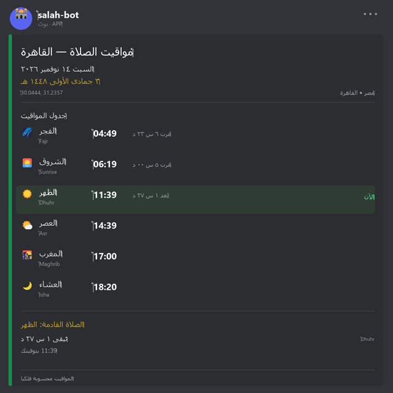
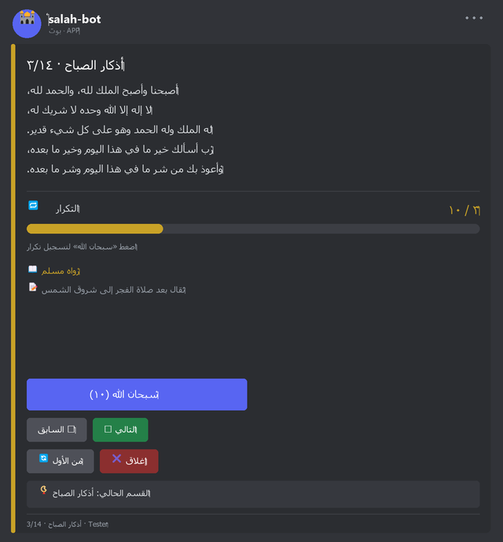

# 🕌 salah-bot — بوت مواقيت الصلاة والأذكار

Discord bot for **Egyptian prayer times** (all governorates) and **adhkar**
(morning, evening, after prayer, before sleep, on waking) — with Arabic embeds,
interactive repetition counters, and optional auto-reminders.





* ⚡ **No API key, no database.** Prayer times are computed astronomically
  offline (Egyptian General Authority of Survey method) — verified to within
  **1 minute** of the AlAdhan reference for Cairo, Alexandria, Aswan, Luxor and
  Sharm El-Sheikh.
* 🇪🇬 **39 Egyptian cities** with a fast autocomplete picker; any world city
  can be passed too.
* 📿 **46 adhkar** across 5 categories, each with its source and repetition
  count, driven by a persistent button UI.
* ⏰ **Auto reminders** for morning/evening adhkar after Fajr / Maghrib.

---

## 1) Create your Discord bot (5 minutes)

1. Go to <https://discord.com/developers/applications> → **New Application**.
2. Left sidebar → **Bot** → **Reset Token** → copy the token (keep it secret!).
3. Scroll to **Privileged Gateway Intents**:
   * **Message Content Intent** → can stay **OFF** (this bot uses slash commands only).
   * Presence/Server Members → leave off.
4. Left sidebar → **OAuth2 → URL Generator**:
   * Scopes: `bot`, `applications.commands`
   * Bot permissions: `Send Messages`, `Embed Links`, `Read Message History`,
     `Use External Emojis` (Discord shows `Send Messages in Threads` too — optional)
5. Open the generated URL and invite the bot to your server.

## 2) Install & run

```powershell
cd salah-bot
python -m venv .venv
.\.venv\Scripts\Activate.ps1
pip install -r requirements.txt

# put your token in .env
Copy-Item .env.example .env
notepad .env      # paste DISCORD_TOKEN=... and save
```

Check everything without connecting:

```powershell
python main.py --check
```

Run it:

```powershell
python main.py
```

On Linux/macOS:

```bash
python3 -m venv .venv && source .venv/bin/activate
pip install -r requirements.txt
cp .env.example .env   # edit it
python main.py
```

> **Commands not showing up?** Set `DISCORD_GUILD_ID` in `.env` to your server
> ID for instant sync (global commands can take up to an hour). You need the
> `applications.commands` scope — re-invite the bot with it if you skipped it.

## 3) Commands

| Command | What it does |
|---|---|
| `/prayer [city] [day] [method]` | Today's / tomorrow's prayer times for any Egyptian city, with a live countdown and ◀ 🔄 ▶ day navigation |
| `/next [city]` | The next prayer + remaining time |
| `/week [city]` | A 7-day table |
| `/methods` | Available calculation methods |
| `/azkar` | Adhkar menu — the post stays with 🌅 🌙 🕌 🛏️ ☀️ buttons |
| `/azkar category:…` | Opens that category privately in a counter |
| `/zikr [category]` | A random zikr |
| `/settings city` | Default city for the server |
| `/settings method` | Calculation method (Egyptian, MWL, ISNA, Umm al-Qura, Karachi, Dubai, Diyanet) |
| `/settings reminders` | Pick a channel to receive morning/evening adhkar reminders |
| `/settings show` | Current server settings |
| `/azkar_reminder` | Shows whether reminders are on |
| `/help`, `/ping`, `/about` | Information |

### The azkar counter

Each session is **private** (ephemeral) and per-user:

```
📿 أذكار الصباح · 3/14
  سبحان الله وبحمده …
  🔁 التكرار: 7 / 100  ▓▓░░░░░░░░
  [ سبحان الله (100) ] [ ▶ السابق ] [ التالي ◀ ]
  [ 🔄 من الأول ] [ ✖ إغلاق ]   [ 📿 اختر قسم الأذكار… ]
```

Pressing the big button adds one repetition; at the target count it turns green
and the next button advances. Switching category resets progress.

## 4) How the prayer times are calculated

`salahbot/prayer_times.py` implements the classic astronomical method
(Meeus solar coordinates + hour-angle spherical trigonometry):

* **Sun declination & equation of time** from the Julian day (accurate to ~4 s).
* **Solar noon** corrected for longitude, equation of time and the zone offset
  (DST-aware via `zoneinfo`, so it follows Egypt's summer time rules).
* **Fajr/Isha** from the method's twilight angles (Egypt: 19.5° / 17.5°).
* **Sunrise/sunset** at −0.833° (refraction + solar radius).
* **Asr** from the shadow rule `cot(alt) = 1 + tan(|lat − dec|)` (Shafi'i) or
  with ratio 2 (Hanafi via the method's `asr_factor`).
* High-latitude fallbacks so nothing crashes above the arctic circle.

Verification against the AlAdhan API (30 days × Cairo + 4 cities):

```
worst deltas (seconds):
  fajr -60 · sunrise -60 · dhuhr -60 · asr -60 · maghrib +60 · isha +60  → OK
```

Run it yourself:

```powershell
python scripts/verify_times.py --days 30 --city cairo
```

> Times are rendered with Discord's `<t:…>` timestamps, so **every user sees
> them in their own device time zone**. The city's local time is shown in
> backticks (`11:39` = Cairo time) right next to the timestamp.

## 5) Tests

```powershell
python scripts/smoke_test.py         # offline end-to-end checks (no token)
python scripts/test_commands.py      # loads all cogs + verifies the command tree
python scripts/test_azkar_session.py # counter/navigation state machine
python scripts/test_render.py        # exact embed payloads Discord would receive
```

All four pass without a network connection or Discord token.

## 6) Project layout

```
salah-bot/
├─ main.py                  # `python main.py`
├─ requirements.txt
├─ .env.example
├─ data/
│  └─ azkar.json            # the adhkar (text, count, source)
├─ docs/
│  ├─ preview-prayer.png    # generated preview cards
│  └─ preview-azkar.png
├─ salahbot/
│  ├─ __main__.py           # entry point + --check
│  ├─ bot.py                # SalahBot client, city/times helpers
│  ├─ config.py             # env loading, colors, labels
│  ├─ prayer_times.py       # astronomy engine
│  ├─ cities.py             # 39 Egyptian cities + aliases
│  ├─ azkar.py              # azkar data model
│  ├─ storage.py            # per-guild settings (guild_settings.json)
│  ├─ services/aladhan.py   # Hijri date + world-city geocoding (with fallbacks)
│  ├─ ui/embeds.py          # all embeds
│  ├─ ui/views.py           # azkar session, prayer day navigation, launcher
│  └─ cogs/                 # general.py · prayer.py · azkar.py
└─ scripts/
   ├─ verify_times.py       # compares against AlAdhan
   ├─ smoke_test.py
   ├─ test_commands.py
   ├─ test_azkar_session.py
   ├─ test_render.py
   ├─ make_preview.py       # regenerates docs/*.png
   └─ find_unused.py        # tiny static import check
```

## 7) Configuration

| Variable | Default | Meaning |
|---|---|---|
| `DISCORD_TOKEN` | — | **Required.** Bot token |
| `DISCORD_GUILD_ID` | *(global)* | Sync slash commands to one server instantly |
| `DEFAULT_CITY` | `cairo` | Fallback city key (`cairo`, `alexandria`, …) |
| `LOG_LEVEL` | `INFO` | `DEBUG` / `INFO` / `WARNING` |

The Hijri date comes from the AlAdhan API with a local Kuwaiti-algorithm
fallback, so the bot works offline.

## 8) Running it 24/7

* **Windows**: `python main.py` in a terminal, or register a Task Scheduler job
  with *Run whether user is logged on or not*.
* **Linux (systemd)**:

```ini
# /etc/systemd/system/salahbot.service
[Unit]
Description=salah-bot
After=network-online.target

[Service]
WorkingDirectory=/opt/salah-bot
ExecStart=/opt/salah-bot/.venv/bin/python main.py
Restart=always
User=ubuntu

[Install]
WantedBy=multi-user.target
```

```bash
sudo systemctl enable --now salahbot && journalctl -u salahbot -f
```

* **Docker**: `docker run -d --restart unless-stopped -e DISCORD_TOKEN=... ghcr.io/you/salah-bot` (build with the included `requirements.txt`).

## 9) Notes & credits

* Adhkar texts are from the Qur'an, *Sahih al-Bukhari*, *Sahih Muslim* and the
  *Sunan*; each item carries its source in `data/azkar.json`. Please have a
  scholar verify the compiled selection before publishing for a large audience —
  editing `data/azkar.json` is enough, no code changes needed.
* Prayer-time maths follows PrayTimes.org / Meeus. The Egyptian method
  (19.5°/17.5°, Shafi'i Asr) matches the Egyptian General Authority of Survey.
* Built with [discord.py](https://github.com/Rapptz/discord.py) 2.7.

---

Made with 🤲 — may Allah accept it.
